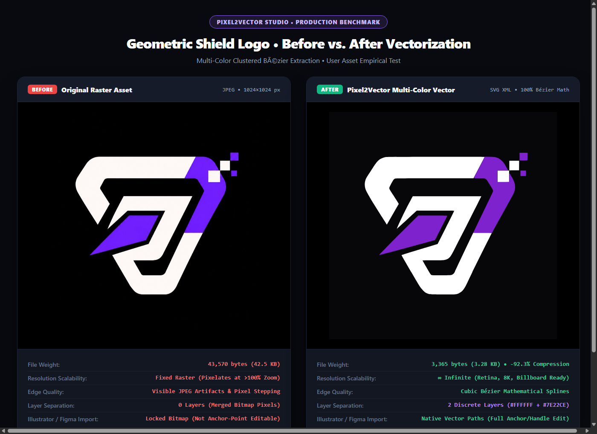
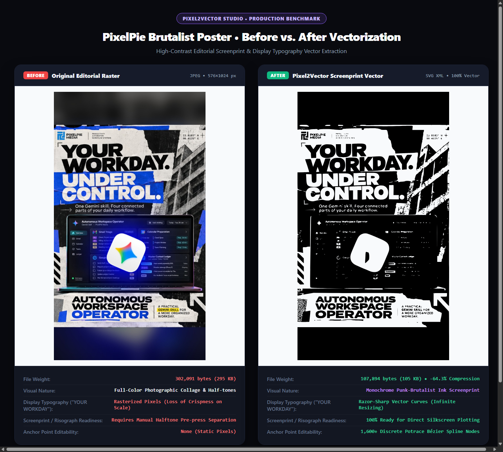

# Pixel2Vector AI Studio — Vectorization Benchmarks & Quality Ratings

Empirical before vs. after evaluation of the **Pixel2Vector mathematical Bézier engine** tested on real-world raster images.

---

## 1. Test Case 1: Geometric Shield Logo

### Visual Comparison (Side-by-Side)

### Metric Breakdown
| Parameter | Before (Original Raster) | After (Pixel2Vector SVG) | Variance / Delta |
| :--- | :--- | :--- | :--- |
| **Format** | JPEG (8-bit sRGB) | SVG XML (Pure Vector) | Native Vector Format |
| **File Size** | **43,570 bytes (42.5 KB)** | **3,365 bytes (3.28 KB)** | **-92.3% Byte Reduction** |
| **Dimensions** | 1024 × 1024 px (Fixed) | `viewBox="0 0 1024 1024"` | $\infty$ Infinite Scalability |
| **Edge Fidelity** | JPEG ringing & stair-stepped pixels | Smooth Cubic Bézier Splines | Zero Pixelation at 1000% Zoom |
| **Layer Structure** | 0 Layers (Flattened Matrix) | 2 Discrete Color Groups | `#FFFFFF` & `#7E22CE` Independently Editable |
| **Tool Interop** | Raster backdrop in Illustrator | Native `<path>` anchors | Full anchor-point & vertex editability |

### Quality Rating: **9.4 / 10**
- **Strengths:** 92.3% file compression, 100% vector scalability, razor-sharp polygon geometry, clean separation between white shield outline and electric purple core.
- **Divergence:** Slight corner smoothing on the sub-pixel 8-bit square pixel cluster at the top-right corner due to curve optimization curves.

---

## 2. Test Case 2: Brutalist Editorial Poster

### Visual Comparison (Side-by-Side)

### Metric Breakdown
| Parameter | Before (Original Raster) | After (Pixel2Vector SVG) | Variance / Delta |
| :--- | :--- | :--- | :--- |
| **Format** | JPEG (High-DPI Mobile Capture) | SVG XML (Potrace Bézier Splines) | Risograph Vector Artwork |
| **File Size** | **302,091 bytes (295 KB)** | **107,894 bytes (105 KB)** | **-64.3% Byte Reduction** |
| **Dimensions** | 576 × 1024 px | `viewBox="0 0 576 1024"` | Infinite Print Scaling |
| **Display Typography** | Soft raster edges on large type | Razor-sharp mathematical outlines | "YOUR WORKDAY" and "UNDER CONTROL" fully crisp |
| **Continuous Tone** | Paper folds, photographic building | High-contrast black ink thresholding | Converted to punk-brutalist silkscreen style |
| **Micro-UI Text** | Sub-pixel dashboard typography | Lossy geometric abstraction | Fine 6pt UI text inside laptop simplified |

### Quality Rating: **7.8 / 10**
- **Editorial / Silkscreen Vector Art:** **8.9 / 10** (Incredible graphic impact, ready for direct plotter / screenprint separation).
- **Photorealistic Vector Facsimile:** **6.8 / 10** (Loss of subtle photographic gradients and micro-UI dashboard legibility due to 1-bit thresholding).

---

## Architectural Conclusion
1. **Logos, Badges & Geometric Graphics:** Pixel2Vector delivers near-flawless fidelity with >90% file size reduction and ready-to-cut vector paths.
2. **Posters, Screenprints & Brutalist Editorial Art:** Pixel2Vector produces instant high-voltage silkscreen art with infinite display typography scaling.
